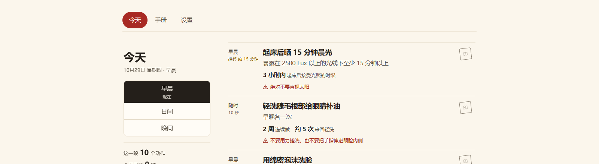

# 生活指南

> 把《生活手册》变成今天能照着做的卡片：每一步、每条禁忌都对着原文核过，离线可用。

[](LICENSE) [](https://github.com/rockbenben/365opensource)

[**⬇ 下载**](https://github.com/rockbenben/life-guide/releases) · Windows / macOS / Linux 桌面版 · Android APK · [**📖 使用指南**](docs/使用指南.md)



你知道自己该做什么，但记不清具体怎么做——晨光要晒多久、睑缘清洗怎么洗、涂防晒要涂几遍。手册写得很细，细到没人会从头读一遍。

生活指南把《生活手册》拆成 518 张卡：**423 张能照着做的动作，95 张疾病知识**。今天要做哪几件，直接列给你；每张卡展开就是原文里的做法、剂量和禁忌，一句一句对着核过。

和「再开一个健康 App」不一样的地方：这里没有算法替你决定该做什么，也没有社交动态，只有一本书的内容，和一份能核对的校验器——卡里每个数字都能回到原文的那句话。

> [!TIP]
> **你的记录只在这台设备上。** 盖章、习惯、清单全存在本机，没有账号、没有服务器、不上传任何东西。换设备用「导出数据 / 导入数据」把记录搬过去。

## 支持范围

| 方面 | 支持情况 |
| --- | --- |
| 形态 | 浏览器 PWA（可装到桌面与手机）、**Windows / macOS / Linux 桌面版**、**Android APK**。同一份构建，各处跑 |
| 内容 | 《生活手册》（NHK 说明书系列）的一次快照：**113 篇全文可读**，已签 **518 张卡**（423 张动作 + 95 张疾病知识） |
| 系统 | Windows 10 及以上（x64 / arm64）；macOS（Intel / Apple Silicon）；Linux（x64 / arm64，AppImage / deb / rpm）；Android 8 及以上；现代浏览器（Chrome / Edge / Safari） |
| 联网 | 只有第一次加载需要网络，之后**完全离线可用**（卡片、步骤图、手册全文都预缓存） |
| 提醒 | 早 7:00、晚 21:00 各一条，可改成每周某几天、每隔 N 天、只一次，也能给单张卡单独设 |
| 语言 | 界面与卡片内容均为中文；卡片文字照抄中文手册快照的原文 |
| 隐私 | 记录只在本机 IndexedDB，不上传、没有账号、免费 |

## 能做什么

- **今天该做哪几件**——按时段（早晨 / 日间 / 晚间）给你这一段的清单，「随时」那几张一直都在
- **每张卡都能查做法**——剂量、步骤、耗时、见效时间、禁忌，展开就写清楚；原文没给的就明说没给
- **盖章不清零**——断几天不算清零（原文说的是「连续 5～6 个月才显现效果」）
- **把书里读到的动作收进来**——手册里任何一篇的卡，点「放进日常」就进你的日常清单（以后都在，频率可单独设）；自己加的习惯也一样
- **闹钟自己响**——桌面 / 手机端不打开 App 也能跟着做；响的时候告诉你这一段该做哪几件
- **手册全文能搜**——113 篇按目录分类，标题正文都能搜；正文按 markdown 渲染，表格、插图、层级列表都在原位
- **数据是你的**——导出成 JSON 换设备；需要闹钟兜底还能导出日历文件（.ics）

## 怎么用

**今天页**——左边按时段切换，右边是这一段的清单。点卡片名展开看细节，点右边的方格盖章；展开后末尾可以「今天不做」（只跳过这一天，明天回来）或「移出日常」（以后不再出现）。手册里没有的习惯，点「加自己的习惯」自己加：填叫什么、做什么（可不填）、什么时候做，加完照样能盖章、设提醒。

**手册页**——搜标题或正文，按目录分类翻。点「放进日常」把动作收进日常清单。

**设置页**——条件（忙 / 出差 / 生病时做什么、年龄段等）、提醒时刻、导出导入数据、装到主屏幕。

## 限制

- 只覆盖《生活手册》这一本书的快照，**不是通用健康建议**，也不能替代医生
- **代码是 MIT；手册正文与图片不是** —— 它们来自 NHK 节目与说明书，版权归原权利人，公开再分发前需取得许可（见 [NOTICE.md](NOTICE.md)）
- 界面只做了中文；桌面版有 Windows / macOS / Linux 构建（x64 + arm64），但只实机验过 Windows；macOS / Linux 还没在真机跑过完整流程
- **桌面安装包还没签名**：Windows 首次运行会有 SmartScreen 提示；macOS 版未签名 / 未公证，需要右键「打开」，且不接自动更新；Linux 的 AppImage 版接自动更新，deb / rpm 版请手动换新包
- **浏览器版的后台提醒会被浏览器压住，可能晚几分钟**，要准点响请用桌面版或手机版
- iOS 还没实机验过（PWA 形态可用，没在 iPhone 上跑过完整流程）
- 主动撤销一次周期完成，会把那一次从累计里扣掉；更早的记录仍在

## 给开发者

本地运行（需要 Node 26+）：

```bash
npm install
npm run dev
```

浏览器打开终端里给的地址即可。打包桌面版与 Android 版见 [使用指南](docs/使用指南.md)。

- [AGENTS.md](AGENTS.md)——设计约定与决策记录（内容层怎么保证「卡里每句话都是原文」）
- 源码在 [GitHub](https://github.com/rockbenben/life-guide) —— 应用里也能一键跳过去（设置 → 关于）
- [ARCHITECTURE.md](ARCHITECTURE.md)——目录结构、数据流、快照与校验器
- [使用指南](docs/使用指南.md)——怎么装、怎么用
- [部署](docs/部署.md)——浏览器 / PWA 那条路的发布步骤
- 常用命令：`npm run content:check`（内容校验）/ `npm test`（479 个单测）/ `npm run test:desktop`（32 个桌面逻辑测试）/ `npm run acceptance`（浏览器级验收）/ `npm run desktop:build`（当前系统的桌面安装包）/ `npm run mobile:sync`（同步进 Android 工程）

## 关于 365 开源计划

[365 开源计划](https://github.com/rockbenben/365opensource) 的第 **#045** 个项目——一个人 + AI，一年 300+ 个开源项目。

[提交你的需求 →](https://365.aishort.top/) · [Discord](https://discord.gg/PZTQfJ4GjX) · [Telegram](https://t.me/aishort_top)
